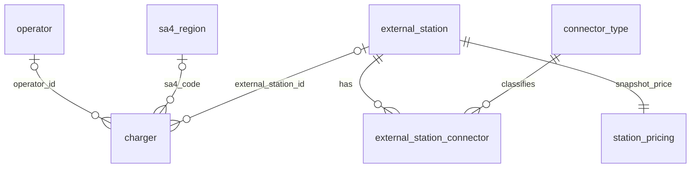

# Data Transformation and Storage

The notebook combines `dc_chargers_augmented.csv` with non-superseded AC and Upcoming records from `ev_chargers_cleaned.csv`, then stores them in `data/processed/ev_chargers.duckdb`. External augmentation applies only to DC records. After registering the CSV inputs, it executes `sql/schema.sql`, which defines all tables, indexes and views, including the temporary loading views, the AC/DC/Upcoming charger-type constraint and the SA4 fallback constraints.

## Schema design

One charger row represents a retained source record, potentially covering several plugs or sharing a site. Normalising operators, regions, external stations and connectors reduces repetition; matching evidence stays on each charger. Original fields remain in `raw_record` JSON for audit. PK denotes primary key; FK denotes foreign key.

| Table | Keys | Stored information |
|---|---|---|
| `operator` | PK: `operator_id` | Unique cleaned operator name. |
| `sa4_region` | PK: `sa4_code` | Region/state names, boundary year, geometry. |
| `charger` | PK: `charger_record_id`; FKs: `operator_id`, `sa4_code`, `external_station_id` | Location, type, plugs, ratings, match/quality flags, source JSON. |
| `external_station` | PK: `external_station_id`; unique provider/ID pair | Provider identity, name, operator, bays, power, verification time, location. |
| `connector_type` | PK: `connector_id` | Unique canonical connector name. |
| `external_station_connector` | Composite PK: `external_station_id`, `connector_id` (both FKs) | Distinct station–connector pairs. |
| `station_pricing` | PK/FK: `external_station_id` | Raw cost, amount, currency, unit, parse status, currency-assumption flag. |

Charger foreign keys are nullable. Multiple chargers may reference one external station, which can report several connector types. Loading creates one pricing observation per external station, including missing prices. The `charger_analysis` view preserves one row per charger; `charger_connector` exposes charger–connector pairs.

## Transformation and interpretation

CSV fields are read as text and converted to schema types; selected empty fields become `NULL`. Provider-prefixed identifiers distinguish OCM and OSM stations. Mixed ratings retain their text without an inferred scalar kW value. Connector aliases are standardised, repeated pairs removed, and OSM metadata tokens excluded from connector relationships.

Only complete, unconditional price rates are parsed. Cents become dollars; `$` and `c` imply AUD with `currency_assumed` flagged. Exact free labels receive zero without an invented unit. Missing, unpriced-fee and unparsed descriptions remain distinct; conditional tariffs retain their original text. Provider claims require caution, and price comparisons must use the same unit.

SA4 boundaries are transformed from EPSG:7844 to EPSG:4326; charger coordinates are assumed to use EPSG:4326, longitude first. `ST_Covers` assigns an SA4 only for exactly one match, retaining the match count otherwise. Non-spatial regions have `NULL` geometry. The 2026 boundaries differ in vintage from the charger snapshot. R-tree indexes support eligible spatial filters.

## Storage and validation

Primary/foreign keys, uniqueness and check constraints enforce identities, relationships, numeric ranges and price/match consistency. A temporary database replaces the output after loading and verifying the input/output charger count, preventing accumulation on reruns. Subsequent assertions check view row preservation, valid charger geometries and pricing coverage for every external station. Saved results show 1,954 charger records, 330 matches to 296 external stations, and 1,953 records assigned to exactly one SA4.

Count matched charger records separately from distinct external stations. Connector categories overlap; aggregate reported bays from `external_station` to avoid duplication. Submit the database alongside `sql/schema.sql`; run the notebook to register the CSV inputs, execute the schema and load the data.
